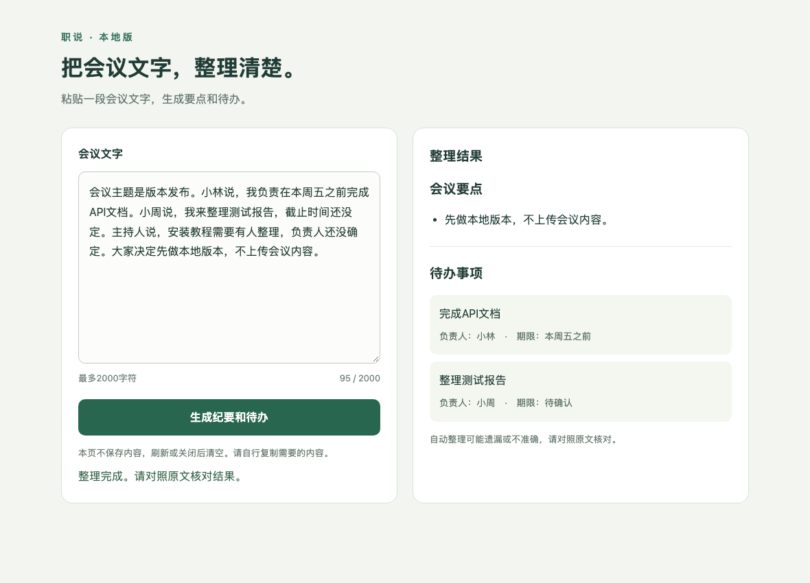

# pm skills

English | [中文](README.zh.md)

## Overview

pm skills is an Agent Skill for people who want to turn a software or Skill idea into a reviewed design, working implementation, tested result and usable handover. Tell Codex what you want to achieve; it organizes the work, asks about decisions that matter, and keeps the project records needed to continue later.

It also handles changes to existing projects, bug fixes and individual research or design tasks. You can discuss an idea without authorizing implementation.

## Preview



An example software delivery using synthetic meeting text; generated content still needs review.

## Features

| Capability | What it helps you do |
|---|---|
| Start a software or Skill project | Turn an idea into requirements, a user flow, and a prototype or invocation example before implementation. |
| Build and verify | Connect the approved design to engineering tasks, real execution, tests and a usable delivery. |
| Change or repair an existing project | Reuse its current requirements and tests, update the affected parts, and keep unrelated work intact. |
| Pause and continue | Preserve decisions, evidence and the next task so another session can pick up the project. |
| Request one deliverable | Ask for research, a design or a test plan without starting an entire development project. |

## Installation

### Requirements

This release supports Codex on macOS. Core project checks use Python; project-specific tools are prepared only when needed and authorized.

| Item | Requirement |
|---|---|
| Agent client | Codex with Skill loading and local command access. |
| System | macOS. Native Windows execution is not supported by this release; Claude Code has not been runtime-tested. |
| Core runtime | Python 3.13 or newer; this release was tested with Python 3.13. |
| Optional project tools | The compiler, browser, model or service needed by your project. No particular model or cloud service is required by pm skills. |

### Quick Installation

Attach the release ZIP in Codex and send:

```text
Install the attached pm skills release. Check my environment, verify the package, and install only this Skill. Keep my existing Skills and projects unchanged, then check that pm skills is recognized. Ask before downloading or changing anything outside this installation.
```

For a published repository release, use:

```text
Install pm skills 3.0.1 from https://github.com/chemny/pm-skills. Verify that the requested version is available; do not substitute an older version. Check the environment, install only this Skill, and verify discovery and loading.
```

The Agent should report the installed version and actual loading result. If the requested version is not available remotely, use the attached ZIP or report the blocker. See the [installation guide](docs/install.md).

## Quick Start

Select **pm skills** in Codex and describe your project:

```text
I want a simple app to paste meeting text and produce notes and todos. Start with the smallest useful version. Show me the requirements, user flow and prototype before writing the application.
```

Review the proposed scope and behavior. Once you authorize implementation, the Agent continues with the technical plan, tasks, actual tests and handover within that scope.

## Usage Examples

### Build a Skill

```text
Help me build a Skill that turns my rough support replies into clear answers. First define its input, output, examples and checks for me to review.
```

### Change an existing application

```text
Add CSV export to this project. Read the current requirements and tests first, explain the affected behavior, and keep the rest unchanged.
```

### Fix a bug

```text
The generate button stays disabled after a failed request. Reproduce it, fix it within the existing requirements, and test failure recovery.
```

### Continue later

```text
Continue this project from its saved records. Tell me what is complete, what is blocked and what is ready next. Keep any paused work paused.
```

### Request only a plan

```text
Prepare a test plan for this design. Do not implement the product or run its models.
```

## How It Works

The main Skill owns the project from goal to handover. It distinguishes discussion, planning and execution, then selects the methods needed for the current task.

| Component | Responsibility |
|---|---|
| `SKILL.md` | Main entry, task routing and authorization boundaries. |
| `references/` | Lifecycle and document contracts, software/Skill profiles, six core engineering methods and optional professional methods. |
| `scripts/` | State and readiness checks, actual execution evidence, task completion and bounded capability discovery. |
| `templates/` | Starting structures for project documents, state and bounded experiments. |
| `agents/` | Codex display name and default prompt. |
| `tools/` | Explicit local installation, update, backup and removal. |

The project keeps one actual state record. Document approval, successful tests and permission to publish remain separate. Checks help detect missing or inconsistent evidence; they do not authenticate human decisions or replace the client’s permissions.

## Repository Structure

```text
SKILL.md
references/
scripts/
templates/
agents/
tools/
docs/
assets/
release.json
release-manifest.json
LICENSE
```

Read the [user guide](docs/usage.md), [installation and recovery guide](docs/install.md), [supported environments](docs/support.md), and [change notes](CHANGELOG.md). The [file contract](references/artifact-contract.md) defines project deliverables; the [method index](references/method-index.md) lists optional methods.

## License

[MIT](LICENSE), with the attributed security-audit method carrying its Apache-2.0 source notice. The existing copyright notices credit Pawel Huryn for the original work and CMM for modifications and additions. See [third-party notices](THIRD-PARTY-NOTICES.md) and the bundled [Apache-2.0 text](licenses/Apache-2.0.txt).

## About Me

Maintained by CMM. The project repository is [chemny/pm-skills](https://github.com/chemny/pm-skills).
